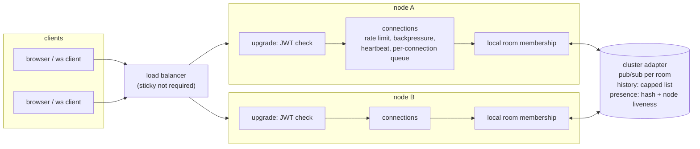

# realtime-presence-chat

[](https://github.com/rahulkumar96t/realtime-presence-chat/actions/workflows/ci.yml)

A WebSocket chat server in TypeScript (Node.js, `ws`) with rooms, presence, typing indicators and
per-room history for late joiners. It covers the parts that usually get skipped in chat demos:
JWT authentication on the upgrade, a versioned and validated message protocol, per-connection
rate limiting, backpressure handling for slow consumers, heartbeats that reap dead connections,
graceful shutdown, Prometheus metrics, and horizontal scaling through a pluggable cluster adapter
(in-memory or Redis). A small browser client is included for trying it out.

## Features

- **Auth:** HS256 JWT checked before the upgrade completes (`Authorization: Bearer` or
  `?access_token=` for browsers). The algorithm is pinned, `sub` and `exp` are required, issuer
  and audience are optional checks, and the socket is closed with `4001` when the token expires.
- **Protocol:** JSON frames with a version field (`v: 1`), validated with zod; optional
  `chat.v1` subprotocol negotiation. Errors come back as typed `error` frames
  (`bad_json`, `unsupported_version`, `invalid_message`, `rate_limited`, `not_in_room`,
  `too_many_rooms`) and the connection stays open. Frames above `maxPayload` close it with 1009.
- **Rooms and presence:** join/leave, member snapshots, presence events per *user* (several tabs
  count once), typing indicators that are not echoed to the typist.
- **History:** the last N messages per room are sent with the join snapshot. Messages that arrive
  while the snapshot is being assembled are buffered and de-duplicated against it, so a late
  joiner sees every message exactly once.
- **Rate limiting:** token bucket per connection (default burst 10, 5 frames/s); excess frames get
  `rate_limited` with `retryAfterMs`, and a client that keeps flooding is closed with 1008.
- **Backpressure:** before each send the server looks at the socket's `bufferedAmount`. Above a
  soft limit, droppable frames (typing) are skipped; above a hard limit the client is
  disconnected instead of letting memory grow without bound.
- **Heartbeat:** ping every interval; a connection that did not answer the previous ping is
  terminated and its presence removed.
- **Horizontal scaling:** fan-out, history and presence go through a `ClusterAdapter`. The
  in-memory adapter serves one process (or several servers sharing a broker in tests); the Redis
  adapter uses pub/sub, capped lists and hashes.
- **Graceful shutdown:** on SIGTERM the node reports `503` on `/readyz` and refuses new upgrades,
  closes sockets with 1001, publishes presence departures, then stops.
- **Observability:** `/metrics` (Prometheus, own registry), `/healthz`, `/readyz`, JSON logs.

## Architecture



A node keeps only its own sockets. When a client sends a message, the node appends it to the
room history and publishes it on the room channel; every node subscribed to that room (the ones
with local members) delivers it to its local sockets, including the sender's node.

### Protocol (v1)

Client to server:

```jsonc
{ "v": 1, "type": "join",    "room": "lobby" }
{ "v": 1, "type": "message", "room": "lobby", "text": "hi", "clientMsgId": "optional-id" }
{ "v": 1, "type": "typing",  "room": "lobby", "isTyping": true }
{ "v": 1, "type": "leave",   "room": "lobby" }
{ "v": 1, "type": "ping" }
```

Server to client: `welcome`, `joined` (members + history), `left`, `message` (with server `id`,
`sentAt`, the sender's `clientMsgId`), `presence` (`join` / `leave`), `typing`, `error`, `pong`.
Room names are 1 to 64 characters of `a-z 0-9 _ -`; message text is trimmed and at most 2,000
characters.

## Quickstart

Requires Node.js 22+.

```bash
npm ci
npm run dev          # http://localhost:8080, in-memory adapter, development tokens enabled
```

Open http://localhost:8080 in two browser windows, pick names and the same room. `npm run dev`
sets `DEV_TOKENS=true`, which exposes `GET /dev/token?name=...` so the demo page can get a token.
That endpoint lets anyone mint tokens and is off by default.

Production-style run:

```bash
npm run build
JWT_SECRET='at-least-32-characters-of-secret....' REDIS_URL=redis://localhost:6379 npm start
JWT_SECRET='at-least-32-characters-of-secret....' npm run token -- user-42 "Ada"   # prints a token
```

Two nodes on one Redis (each with its own `PORT`) form a cluster; clients on either node share
rooms, history and presence.

### Configuration

| Variable | Default | Meaning |
| --- | --- | --- |
| `JWT_SECRET` | (required, 32+ chars) | HS256 signing secret |
| `JWT_ISSUER`, `JWT_AUDIENCE` | unset | Checked when set |
| `PORT`, `HOST` | `8080`, `0.0.0.0` | Listen address |
| `REDIS_URL` | unset | Use the Redis adapter; otherwise in-memory (single node) |
| `REDIS_KEY_PREFIX`, `NODE_ID` | `chat:`, random | Key namespace, node identity |
| `HEARTBEAT_INTERVAL_MS` | `30000` | Ping interval; no pong before the next ping disconnects |
| `RATE_LIMIT_CAPACITY`, `RATE_LIMIT_REFILL_PER_SECOND`, `RATE_LIMIT_MAX_VIOLATIONS` | `10`, `5`, `20` | Token bucket and flood cut-off |
| `BACKPRESSURE_SOFT_BYTES`, `BACKPRESSURE_HARD_BYTES` | 256 KiB, 1 MiB | Drop typing / disconnect thresholds |
| `MAX_PAYLOAD_BYTES` | 16 KiB | Largest inbound frame |
| `MAX_ROOMS_PER_CONNECTION`, `HISTORY_SIZE` | `20`, `50` | Limits |
| `SHUTDOWN_GRACE_MS` | `5000` | Time for clients to finish the close handshake |
| `DEV_TOKENS`, `LOG_LEVEL` | `false`, `info` | Demo token endpoint, log verbosity |

## Design decisions and trade-offs

- **Shared state lives in the adapter, sockets stay local.** History and presence are stored in
  the backend (Redis lists and hashes), not reconstructed from the event stream, so a node that
  starts later or has no members in a room still serves a correct snapshot. The cost is a
  backend round trip per join and per message.
- **Join ordering.** A joining connection becomes a local member first and buffers live events,
  then the node reads history and presence, sends the snapshot and flushes the buffer minus
  messages already in the history. Without this, a message published between "read history" and
  "start delivering" is either lost or shown twice.
- **One queue per connection.** All work for a connection (joins, messages, the clean-up after
  disconnect) runs in order on a promise chain, so a disconnect cannot overtake a join that is
  still talking to Redis and leave a ghost presence behind.
- **Atomic presence without Lua.** The Redis adapter reads the presence hash in the same
  `MULTI/EXEC` that writes it, so "was this user already here?" is answered from a consistent
  snapshot and two nodes adding the same user concurrently produce exactly one join event.
- **Crashed nodes.** Each node writes a heartbeat timestamp; presence entries of nodes silent for
  longer than the TTL (15 s by default) are ignored and lazily deleted. Their users disappear from
  member lists, but no `leave` event is broadcast for them (nobody is left to send it). Node clocks
  are assumed to be within a few seconds of each other.
- **Slow consumers are cut off, not buffered.** A client that stops reading would otherwise make
  the server hold its outbound messages in memory indefinitely. Typing indicators are dropped
  first; persistent lag disconnects the client (it can reconnect and rejoin, receiving history).
  The disconnect is a terminate rather than a close frame, because a close frame would queue
  behind the data the client is not reading.
- **Rate limiting before parsing.** The token bucket is charged before JSON parsing and
  validation, so invalid frames cost the same as valid ones.
- **Token in the query string for browsers.** Browsers cannot set headers on a WebSocket
  handshake. Query strings can end up in proxy logs, so tokens should be short-lived; a ticket
  endpoint that exchanges a bearer token for a one-time connect ticket would be the next step.
- **Messages are at-most-once on the wire.** Delivery is best effort per socket; a client that
  reconnects re-joins and gets the recent history. There are no per-client acknowledgements or
  replay cursors.

## Testing

```bash
npm test                                   # vitest; real-Redis cases skip without a server
REDIS_URL=redis://127.0.0.1:6379 npm test  # also runs the adapter contract on a real Redis
```

The integration tests start real servers on ephemeral ports and talk to them with real `ws`
clients:

- auth: header and query tokens, subprotocol negotiation, missing / expired / wrongly signed /
  unsigned (`alg: none`) / audience-mismatched tokens, token expiry closing the socket;
- rooms: snapshots, presence join/leave, multi-tab presence, room limits, broadcast with echo,
  typing not echoed, history cap, exactly-once delivery to a client joining mid-stream;
- protocol errors, oversized frames, rate limiting and the flood cut-off;
- heartbeat reaping a client that ignores pings (`autoPong: false`);
- a slow consumer (paused socket) being disconnected while the fast member is unaffected;
- two server instances sharing an in-memory broker: cross-node messages, history, typing,
  presence, and graceful shutdown of one node while the other keeps serving;
- metrics, health, readiness and configuration.

The `ClusterAdapter` contract (fan-out, unsubscribe, history order and cap, per-user presence,
concurrent joins) runs against the in-memory broker, against the Redis adapter on
[`ioredis-mock`](https://github.com/stipsan/ioredis-mock) in every run, and against a real Redis
when one is reachable at `REDIS_URL` (default `redis://127.0.0.1:6379`). A separate test covers
presence cleanup after a node stops heart-beating.

CI starts a `redis:7-alpine` service container, so every CI run executes all 77 tests, including the
real-Redis cases. Locally, without a Redis server, 72 pass and those 5 are skipped, in about 2
seconds (Node 22.23.4 and 25.6.1, macOS, Apple M4 Pro).

## Limitations and roadmap

- Not load-tested; no throughput or latency figures are claimed.
- Redis pub/sub fan-out sends every room message to every node with members in that room; very
  large deployments would shard rooms or use Redis Streams.
- The Redis adapter assumes a single Redis (or a primary with replicas), not Redis Cluster, since
  presence transactions touch two keys.
- No message persistence beyond the capped history, no edits, deletes, read receipts or
  moderation.
- Typing state is not cleared server-side on disconnect; the demo client expires indicators after
  five seconds.
- Next steps: connect tickets instead of query-string tokens, per-user (not per-connection) rate
  limits shared through the adapter, resumable sessions with message cursors.

## License

MIT, see [LICENSE](LICENSE).
